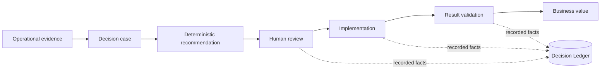

# IMPERATOR

### Operational decisions, backed by evidence.

**IMPERATOR connects operational evidence to a recommendation, a human decision and a validated outcome.** It helps engineering, finance and audit teams answer: **Why was this change proposed? Who approved it? Did it deliver the expected value?**

Built as a **local academic MVP** with Java 21, Spring Boot, Next.js and PostgreSQL. One synthetic case demonstrates the complete decision lifecycle; cloud deployment is a later, gated phase.

[](https://github.com/Dmillan-dev/ImperatorProyect/actions/workflows/java-ci.yml)
[](https://github.com/Dmillan-dev/ImperatorProyect/actions/workflows/security.yml)

[Explore the workflow](#how-it-works) · [See the demo](#the-demonstrated-case) · [Architecture](#architecture) · [Project status](#current-stage) · [Documentation](#documentation)

## Why IMPERATOR?

Operational records often explain **what happened**, while the reasons, approvals and results of a change are scattered across tools. IMPERATOR brings those links into one review workspace and a persistent decision history.

| User | Practical value |
| --- | --- |
| Engineering | Trace the evidence and assumptions behind a proposed change; record implementation. |
| Finance | Compare estimated value with a result validated against post-action evidence. |
| Decision owner | Approve or reject with explicit responsibility and a recorded reason. |
| Audit | Reconstruct the sequence of evidence, recommendation, actors and outcomes. |

## How it works



- **Evidence:** import normalized facts and preserve their references.
- **Recommendation:** apply a fixed business policy to calculate the proposal and estimated value.
- **Governance:** require the assigned human actor, the correct role and the permitted sequence of actions.
- **Decision Ledger:** retain ordered governance facts; the application database role cannot update or delete its history.
- **Business Value:** project a validated result from persisted implementation and validation facts.

An optional AI explanation can accompany the recommendation. **Business rules calculate the result; humans retain approval authority.** The provider cannot change amounts, approve decisions or write the Ledger.

## The demonstrated case

**`DRC-AOA-001` — optimize the cost of an AI onboarding assistant.** Thirty synthetic evidence records support a `MODEL_CHANGE` recommendation: use a lower-cost model for routine requests and retain a more capable fallback for exceptions.

| Estimated annual recovery | Validated simulated annual recovery | Variance |
| ---: | ---: | ---: |
| €19,440 | €18,960 | −€480 |

These are **synthetic evaluation values**. Twenty-eight records support the recommendation; two post-action records support implementation and result validation.


*Actual local rehearsal capture, 9 October 2026. The dates shown inside the workspace belong to the synthetic dataset.*

Four roles participate: **ADMIN, PLATFORM_ENGINEER, FINANCE and AUDITOR**. In the recorded rehearsal, approval uses the UI; implementation and financial validation use authenticated API commands, with results then displayed in the workspace. See the [rehearsal report](docs/tfg/evidence/2026-10-09-gosu-security-closure/runtime/capture/rehearsal.json).

## Architecture

| Layer | Implementation |
| --- | --- |
| Workspace | Next.js / React / TypeScript; one decision-review workspace. |
| Backend | Java 21 / Spring Boot modular monolith; hexagonal Domain, Application, ports and adapters. |
| Persistence | PostgreSQL, explicit JDBC transactions and Flyway V1–V3 migrations. |
| Authorization | RS256 JWT validation, four-role RBAC and server-side actor/state checks. |
| Local delivery | Hardened Docker images, Compose and internal liveness/readiness probes. |
| Repository automation | GitHub Actions, Maven, frontend checks, Trivy, Gitleaks and CodeQL. |

Business policy stays independent of HTTP, Spring, JDBC and provider SDKs. Read-only GitHub/AWS evidence adapters and an optional Amazon Bedrock explanation adapter are implemented; live provider validation remains pending.

The AWS target uses **ECS/Fargate, RDS, Terraform and GitHub OIDC**. Its deployment, provider validation and operational costs remain pending. [Architecture](docs/tfg/05_ARCHITECTURE.md) · [Local versus AWS](docs/tfg/06_LOCAL_VS_AWS.md).

## Current stage

**Local academic MVP / pre-pilot.** The core workflow is implemented and has local execution evidence. Formal academic delivery remains in progress.

| Area | State |
| --- | --- |
| Core workflow, four roles and PostgreSQL persistence | Implemented and validated in the local synthetic rehearsal. |
| Tests | 174 backend unit, 35 PostgreSQL integration and 41 frontend tests passed in the 9 October evaluation; Playwright: 9 passed, 6 intentional skips. |
| Docker/runtime | RBAC, Flyway, persistence after recreation and readiness/recovery validated on the identified local images. |
| Security | 13 October scans: 0 fixable High/Critical and 0 secrets across four retained images; 25 residual CVEs await the current R-20 decision. R-23 development tooling remains open. |
| Optional AI | Explanation adapter tested offline; live Bedrock validation pending. |
| AWS | Target architecture and delivery preparation exist; live deployment remains pending and gated. |
| TFG delivery | Applicable security decision, final version closure, narrated defence and tutor review pending. |

Exact SHAs, image digests, scanner reports and historical decisions belong in the [evidence record](docs/tfg/evidence/2026-10-13-main-closure/README.md) and [security gate](docs/tfg/TFG_A_SECURITY_CLOSURE_GATE.md). Earlier risk acceptance has expired; it does not authorize a new run or different images.

## Explore and verify locally

Start with the [backend guide](backend-java/README.md), [frontend guide](frontend/README.md) and [local defence preflight](docs/tfg/A_S4_LOCAL_DEFENSE.md). The rehearsal uses isolated synthetic data and a local HTTPS/JWKS fixture; external identity-provider conformance is a separate gate.

With Java 21, run backend verification from the repository root:

```powershell
.\mvnw.cmd clean verify
```

With Node.js 24 and npm 11, run frontend checks:

```powershell
cd frontend
npm ci
npm run format:check
npm run lint
npm run typecheck
npm run test:coverage
```

Database integration, browser tests, build and Docker execution require their documented inputs. Follow the [integration configuration](backend-java/README.md#persistence-certification), [frontend quality gates](frontend/README.md#quality-gates) and [runtime preflight](docs/tfg/A_S4_LOCAL_DEFENSE.md#preflight-obligatorio-antes-de-ejecutar) before executing them. The current exact-image security decision is still pending.

## Repository guide

| Path | Purpose |
| --- | --- |
| `backend-java/` | Business rules, use cases, ports, adapters and REST API. |
| `src/test/` | Backend tests and versioned synthetic fixtures. |
| `frontend/` | Decision Review Workspace and UI tests. |
| `database/` | Flyway schema migrations. |
| `infra/docker/` | Local runtime, images and verification. |
| `infra/aws/` | Terraform and future cloud-delivery preparation. |
| `docs/tfg/` | Scope, requirements, memory, risks, defence and evidence. |
| `docs/architecture/`, `docs/decisions/` | Technical contracts and design decisions. |

## Documentation

- **Understand the product:** [academic scope](docs/tfg/01_ACADEMIC_SCOPE.md) · [architecture](docs/tfg/05_ARCHITECTURE.md) · [technical evidence](docs/portfolio/technical-evidence.md).
- **Review the delivery:** [project status](docs/project/PROJECT_STATUS.md) · [traceability](docs/tfg/03_TRACEABILITY_MATRIX.md) · [risks and scope control](docs/tfg/00_TFG_MASTER_PLAN.md#6-risks-and-scope-control).
- **Finish the TFG:** [memory draft](docs/tfg/08_LOCAL_MVP_MEMORY.md) · [DAM delivery guide](docs/tfg/11_DAM_MEMORY_DELIVERY.md) · [twelve-minute defence](docs/tfg/09_DEFENSE_SCRIPT_12_MIN.md).
- **Portfolio introduction:** [Featured Project](docs/portfolio/featured-project.md).

Report vulnerabilities privately through [SECURITY.md](SECURITY.md). Portfolio and academic review are governed by the [all-rights-reserved license](LICENSE).
