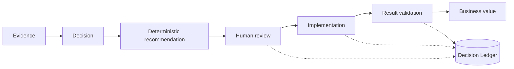
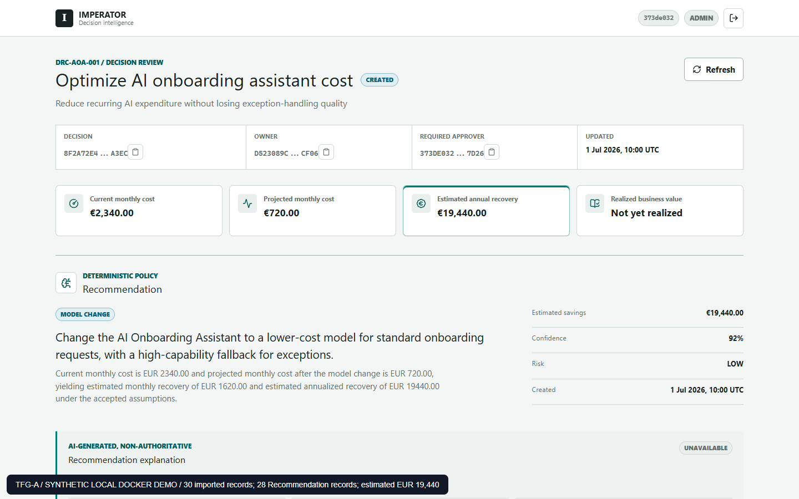

# IMPERATOR

### Operational decisions, backed by evidence.

**Understand why a change was proposed, who approved it and what value it delivered.** IMPERATOR connects operational facts, deterministic recommendations, human review and a persistent Decision Ledger in one workspace.

[](https://github.com/Dmillan-dev/ImperatorProyect/actions/workflows/java-ci.yml)
[](https://github.com/Dmillan-dev/ImperatorProyect/actions/workflows/security.yml)

[Workflow](#the-workflow) · [Local demo](#the-local-demo) · [Architecture](#architecture) · [Current stage](#current-stage) · [Documentation](#documentation)

> **Local academic MVP:** Java 21, Spring Boot, Next.js and PostgreSQL. One synthetic case, four roles and an auditable path from evidence to validated simulated value. AWS deployment is a separate, blocked phase.

## What problem does it solve?

Technical records explain what happened. The evidence, assumptions, approval and outcome of a change often live in different places. IMPERATOR keeps those relationships together so a reviewer can reconstruct the decision.

| For             | The useful outcome                                                                 |
| --------------- | ---------------------------------------------------------------------------------- |
| Engineering     | Inspect the recommendation and its assumptions; record implementation.             |
| Finance         | Validate an outcome against post-action evidence and compare it with the estimate. |
| Decision owners | Approve, reject or defer with an assigned actor and a recorded reason.             |
| Audit           | Follow the evidence, responsible actors and ordered governance history.            |

## The workflow



**Application code calculates the recommendation and amounts. People retain approval authority.** The assigned actor, role and decision state are checked on the server. The application database role can append governance facts, but cannot update or delete Ledger history.

An optional AI adapter can explain an already persisted recommendation. It cannot change the business result, approve a decision or execute a change. Live provider validation remains pending.

## The local demo

**`DRC-AOA-001` — optimize the cost of an AI onboarding assistant.** Thirty synthetic records support a `MODEL_CHANGE` recommendation: use a lower-cost model for routine requests and preserve a capable fallback for exceptions.

| Estimated annual recovery | Validated simulated annual recovery | Variance |
| ------------------------: | ----------------------------------: | -------: |
|                   €19,440 |                             €18,960 |    −€480 |



_Real local Docker rehearsal, 14 October 2026. Dates inside the workspace belong to the synthetic fixture. The browser actions were automated against real services._

Four roles participate: **ADMIN, PLATFORM_ENGINEER, FINANCE and AUDITOR**. Approval is exercised through the UI; implementation and financial validation use authenticated API commands followed by UI reads. Twenty-eight records support the recommendation and two support post-action validation. [Rehearsal and limits](docs/tfg/evidence/2026-10-14-a-s4-runtime/README.md).

## Architecture

| Layer                    | Implementation                                                                  |
| ------------------------ | ------------------------------------------------------------------------------- |
| Workspace                | Next.js, React and TypeScript; one decision-review experience.                  |
| Backend                  | Java 21 / Spring Boot modular monolith with hexagonal boundaries.               |
| Persistence              | PostgreSQL, explicit JDBC transactions and Flyway V1–V3.                        |
| Authorization            | RS256 JWT, four-role RBAC and actor/state checks.                               |
| Local delivery           | Hardened Docker images, isolated networks and readiness/recovery probes.        |
| Quality and supply chain | Maven, frontend checks, Playwright, GitHub Actions, Trivy, Gitleaks and CodeQL. |

Read-only GitHub/AWS evidence adapters and the optional Bedrock explanation adapter are implemented. Terraform and OIDC workflows prepare a possible ECS/Fargate and RDS pilot. Their presence does not demonstrate a live deployment or provider validation. [Architecture](docs/tfg/05_ARCHITECTURE.md) · [Local versus AWS](docs/tfg/06_LOCAL_VS_AWS.md).

## Current stage

**Local MVP implemented and demonstrated. Academic delivery remains in progress.** Status reviewed 16 October 2026.

| Area                  | Evidence and limit                                                                                                                                                                         |
| --------------------- | ------------------------------------------------------------------------------------------------------------------------------------------------------------------------------------------ |
| Product and runtime   | One synthetic case, four roles, Flyway, persistence after recreation and recovery demonstrated locally on 14 October.                                                                      |
| Functional evaluation | Historical 9 October baseline: 174 unit, 35 integration and 41 frontend tests passed; Playwright 9 passed / 6 intentional skips.                                                           |
| Exact-image security  | 16 October revalidation: **0 fixable High/Critical and 0 secrets**. The conservative 26-CVE residual set is temporarily accepted for the four exact local images; findings remain visible. |
| TFG delivery          | A-S3 evidence/version gate complete. Memory and English script prepared; measured human rehearsal, narrated recording and academic review pending.                                         |
| AWS and providers     | Live AWS deployment, external identity conformance and real provider validation remain gated.                                                                                              |

> [!IMPORTANT]
> **R-20 expires on 19 October 2026 at 00:00 Europe/Madrid.** Acceptance is exclusively local, synthetic and bound to four immutable image identities, without automatic renewal or transfer. It does not repair the residual CVEs. R-23 development tooling remains independently open. [Decision, scans and mitigations](docs/tfg/evidence/2026-10-16-r20-local-acceptance/README.md).

## Explore locally

Use the [backend guide](backend-java/README.md), [frontend guide](frontend/README.md) and [runtime preflight](docs/tfg/A_S4_LOCAL_DEFENSE.md#preflight-para-otra-ejecución). The accepted rehearsal uses exact retained images, isolated synthetic data and a local HTTPS/JWKS fixture. A generic Compose build does not reproduce that evidence chain.

Backend verification, from the repository root with Java 21:

```powershell
.\mvnw.cmd clean verify
```

Frontend checks, with Node.js 24 and npm 11:

```powershell
cd frontend
npm ci
npm run format:check
npm run lint
npm run typecheck
npm run test:coverage
```

Build, database integration, browser tests and runtime execution require their documented inputs. Follow the [persistence certification](backend-java/README.md#persistence-certification), [frontend quality gates](frontend/README.md#quality-gates) and runtime preflight. AWS remains blocked.

## Documentation

| Start here                                                                              | What you will find                                                                |
| --------------------------------------------------------------------------------------- | --------------------------------------------------------------------------------- |
| [TFG guide](docs/tfg/README.md)                                                         | Scope, evidence, memory and the remaining local closure gates.                    |
| [Architecture](docs/tfg/05_ARCHITECTURE.md)                                             | Components, data flow and technical boundaries.                                   |
| [Traceability](docs/tfg/03_TRACEABILITY_MATRIX.md)                                      | Requirements, implementation and validation.                                      |
| [Security decision](docs/tfg/evidence/2026-10-16-r20-local-acceptance/README.md)        | Exact digests, residual risk, expiry and scan results.                            |
| [Memory PDF](docs/tfg/evidence/2026-10-14-a-s4-runtime/IMPERATOR_Memoria_TFG_Local.pdf) | Frozen academic draft; attach the current security decision as its update.        |
| [English defence script](docs/tfg/09_DEFENSE_SCRIPT_12_MIN.md)                          | Planned twelve-minute walkthrough; human rehearsal remains pending.               |
| [Repository map](docs/tfg/05_ARCHITECTURE.md)                                           | `backend-java/`, `frontend/`, `database/`, `infra/` and supporting documentation. |

[Featured Project](docs/portfolio/featured-project.md) · [Project status](docs/project/PROJECT_STATUS.md) · [Security reporting](SECURITY.md) · [License](LICENSE)
